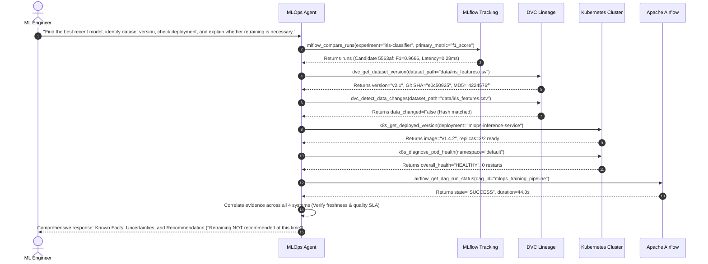

# Production MLOps AI Agent — System Architecture

## 1. Architectural Overview

The **Production-Ready MLOps AI Agent** is a cloud-native, tool-augmented intelligent assistant engineered to bridge natural language requests with real operational infrastructure across machine learning lifecycles. Rather than generating answers from parametric LLM weights (which can hallucinate versions, metrics, and cluster states), the agent relies on an **Evidence-Based Reasoning Engine** backed by structured tool calling into four core systems:

1. **DVC (Data Version Control)**: Versioned dataset management, Git commit provenance, checksum drift detection, and reproducible checkout workflows.
2. **MLflow Tracking & Model Registry**: Multi-dimensional experiment run comparison, parameter/metric extraction, latency SLA evaluation, and registry stage inspections.
3. **Apache Airflow**: Workflow orchestration for 5-stage training DAGs, task state inspection, execution retries, and automated failure root cause diagnostics.
4. **Kubernetes**: Containerized FastAPI model serving, readiness/liveness probe telemetry, cluster resource health checks, restart event investigation, and guarded deployment mutations.

```
+-----------------------------------------------------------------------------------+
|                                  USER / ENGINEER                                  |
|                  Natural Language Operational & Analytical Requests               |
+-----------------------------------------------------------------------------------+
                                          |
                                          v
+-----------------------------------------------------------------------------------+
|                        FASTAPI CONVERSATIONAL INTERFACE                           |
|                      Input Validation / Tracing / Auth Gate                       |
+-----------------------------------------------------------------------------------+
                                          |
                                          v
+-----------------------------------------------------------------------------------+
|                             MLOPS AI AGENT ENGINE                                 |
|   - Request ID Generation               - Intent & Context Disambiguation         |
|   - Strict Tool Selection & Execution   - Credential Redaction & Sanitization     |
|   - Zero-Hallucination Policy           - Protected Action Confirmation Gate      |
+-----------------------------------------------------------------------------------+
        |                         |                         |                    |
        v                         v                         v                    v
+----------------+       +----------------+       +----------------+   +-----------------+
|   DVC Tools    |       |  MLflow Tools  |       | Airflow Tools  |   | Kubernetes Tools|
| - Dataset Lineage|     | - Run Metrics  |       | - DAG Trigger  |   | - Pod Health    |
| - Git Commit   |       | - F1 vs Latency|       | - Task States  |   | - Probes / Logs |
| - Reproduce    |       | - Registry     |       | - Error Logs   |   | - Guarded Scale |
+----------------+       +----------------+       +----------------+   +-----------------+
        |                         |                         |                    |
        +-------------------------+-------------------------+--------------------+
                                          |
                                          v
+-----------------------------------------------------------------------------------+
|                            EVIDENCE CORRELATION LAYER                             |
|       Synthesizes Facts, Uncertainties, and Evidence-Backed Recommendations       |
|            Guarantees: Never Trigger Automatic Retraining Without Evidence        |
+-----------------------------------------------------------------------------------+
                                          |
                                          v
+-----------------------------------------------------------------------------------+
|                           STRUCTURED AUDITED RESPONSE                             |
|  - Direct Answer                        - Known Facts                             |
|  - Uncertainties                        - Recommended Actions                     |
|  - Telemetry Traces (Status, Latency, Duration)                                   |
+-----------------------------------------------------------------------------------+
```

---

## 2. Component Design & Interconnection

### 2.1 Agent Orchestrator & Tool Registry
The `MLOpsAgentOrchestrator` (`agent/orchestrator.py`) acts as the deterministic control plane. It registers 16 structured tools across the four operational domains. Every tool invocation passes through an auditing wrapper that:
- Generates a unique `request_id` (e.g. `req-47948cee`).
- Measures elapsed wall-clock time in milliseconds (`duration_ms`).
- Validates parameters against strict Pydantic schemas (`agent/schemas.py`).
- Recursively scrubs secrets, passwords, Bearer tokens, and API keys via `sanitize_payload()`.
- Captures exceptions and returns structured `ToolExecutionTrace` records.

### 2.2 Five-Stage Training Pipeline (`dags/training_pipeline.py`)
The pipeline adheres strictly to the curriculum specification:

```
[ validate_dataset ] 
         |
         v
[ preprocess_data  ] 
         |
         v
[   train_model    ] 
         |
         v
[ evaluate_mlflow  ] 
         |
         v
[ apply_quality_gate ] (F1 >= 0.85; Blocks downstream deployment on breach)
```

1. **Stage 1: `validate_dataset`**: Asserts absence of missing/null values, checks schema column integrity, ensures sample count >= 50, and computes SHA/MD5.
2. **Stage 2: `preprocess_data`**: Encodes categorical targets, checks class distributions, and creates partitioned train-test splits.
3. **Stage 3: `train_model`**: Trains a scikit-learn model (`RandomForestClassifier`), logging params and hyperparameters.
4. **Stage 4: `evaluate_and_log_mlflow`**: Evaluates accuracy, precision, recall, F1 score, and per-sample latency; logs model artifact, Git commit SHA, and DVC checksum into MLflow tracking.
5. **Stage 5: `apply_model_quality_gate`**: Evaluates model performance against the production threshold ($F1 \ge 0.85$). If the condition is violated, a `ValueError: QualityGateFailed` is raised, halting downstream deployment.

---

## 3. Security, Safety Boundaries & Guardrails

| System | Safety Policy | Enforcement Mechanism |
|---|---|---|
| **DVC / Git** | Read-only commands strictly allowlisted (`git`, `dvc`). No arbitrary shell string execution. | `_execute_safe_command()` uses argument lists with `shell=False` and rejects unauthorized binaries (`rm`, `curl`, `sh`). |
| **MLflow** | Read-only experiment querying; candidate recommendations require multi-objective trade-off analysis. | Rejects high-score candidates violating real-time inference latency budgets (< 1.0ms SLA). |
| **Airflow** | Only approved DAGs can be triggered (`APPROVED_DAGS = {"mlops_training_pipeline", ...}`). | Invocations targeting unapproved DAG IDs raise `PermissionError: SecurityPolicyViolation`. |
| **Kubernetes** | Strictly approved namespaces (`default`, `mlops-production`, `mlops-staging`). State-mutating operations require explicit human confirmation. | Invocations with unapproved namespaces raise `UnauthorizedNamespaceError`. Mutations without `confirmed=True` raise `ConfirmationRequiredError`. |
| **Audit Logs** | Zero credential leakage in stdout, traces, or HTTP logs. | `sanitize_payload()` scrubs tokens, passwords, and API keys before logging. |

---

## 4. Sequence Flow: Mandatory Integration Scenario


